# GeoServicios y Websites

Modulo 0 - Nivelacion SIG

Autora: Jenifer Alexandra Huertas Lopez

Herramientas:
- Git y GitHub
- Visual Studio Code
- Docker
- PostGIS
- GeoServer
- Leaflet

## Verificacion Git
Rama de prueba creada desde VS Code para el Modulo 0.

## Evidencias de funcionamiento

Las capturas documentan el funcionamiento local comprobado durante el desarrollo. Las imágenes muestran la configuración y la visualización observadas; no sustituyen pruebas de despliegue reproducible ni de validación topológica exhaustiva.

### 01. Contenedores Docker de PostGIS, GeoServer y pg_tileserv

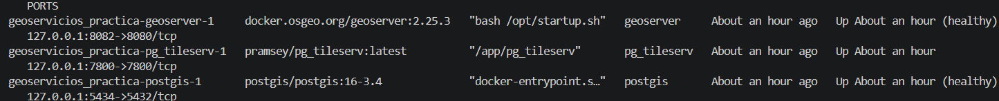

### 02. Tabla de atributos de QGIS con 1.122 municipios

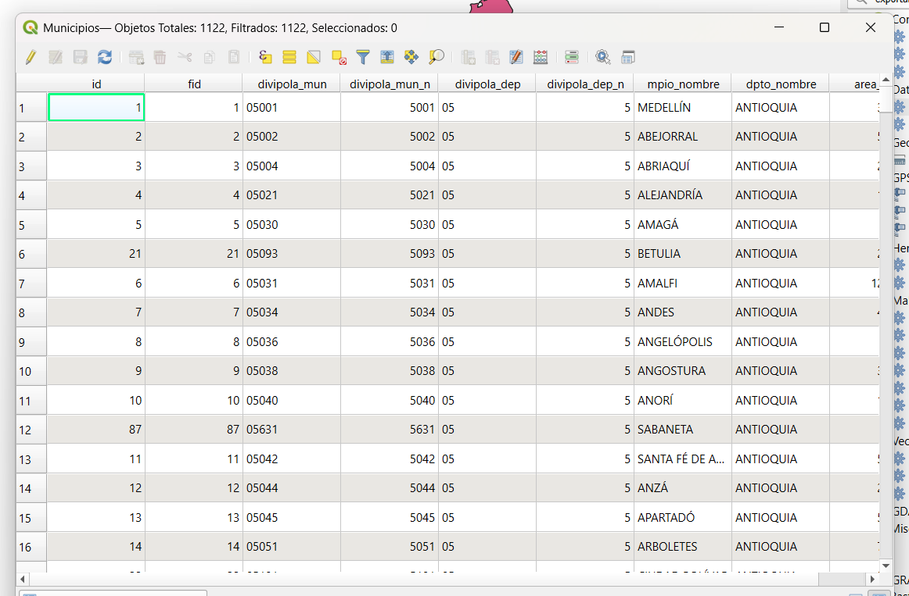

### 03. Catálogo de capas publicado por pg_tileserv

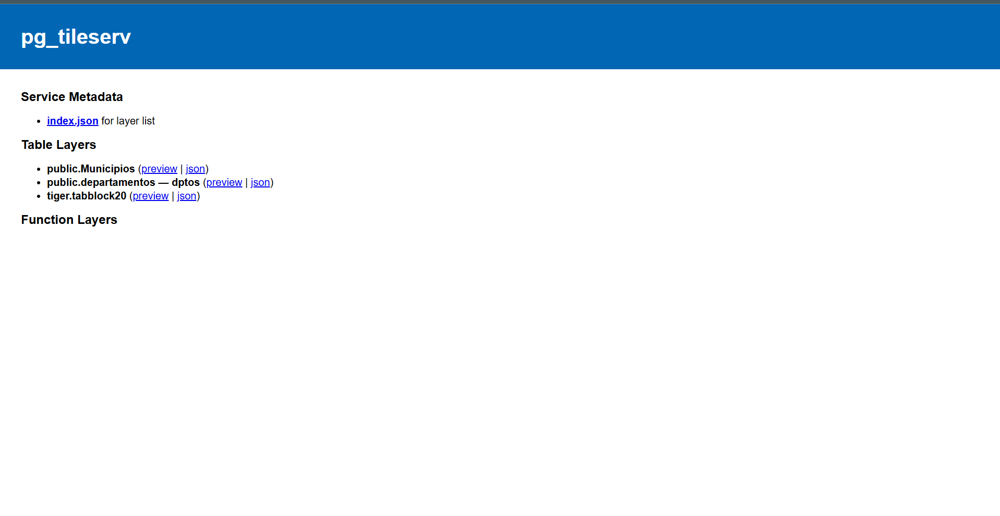

### 04. Vista previa de teselas vectoriales municipales

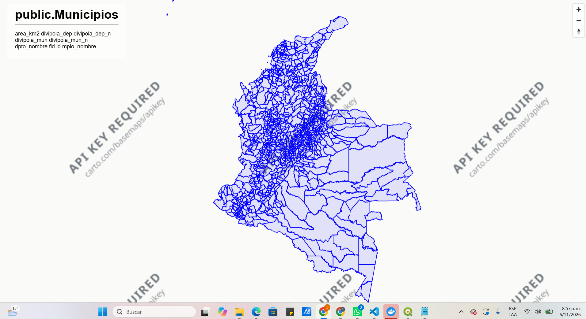

### 05. Servicio WMS de municipios en GeoServer

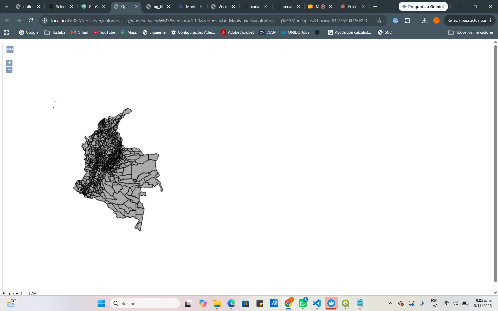

### 06. Servicio WMS de departamentos en GeoServer

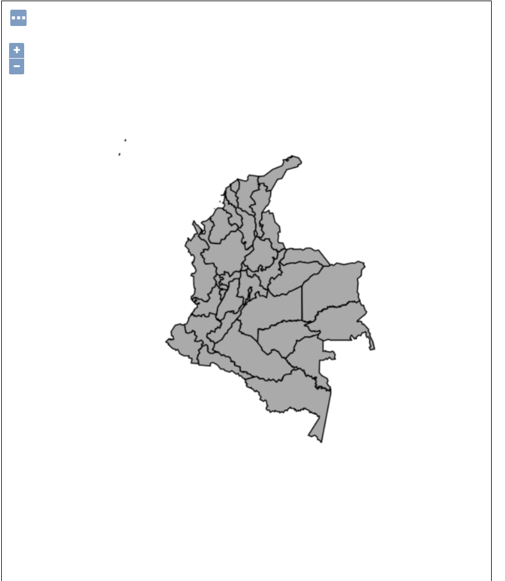

### 07. Visor Leaflet con límites departamentales

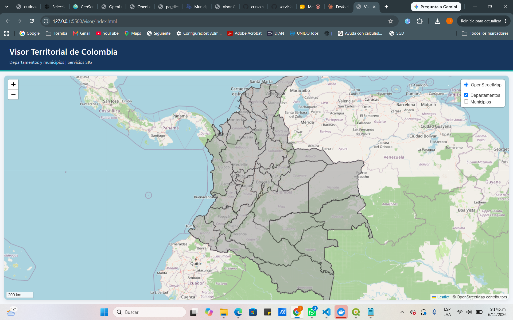

### 08. Visor Leaflet con municipios y departamentos activados

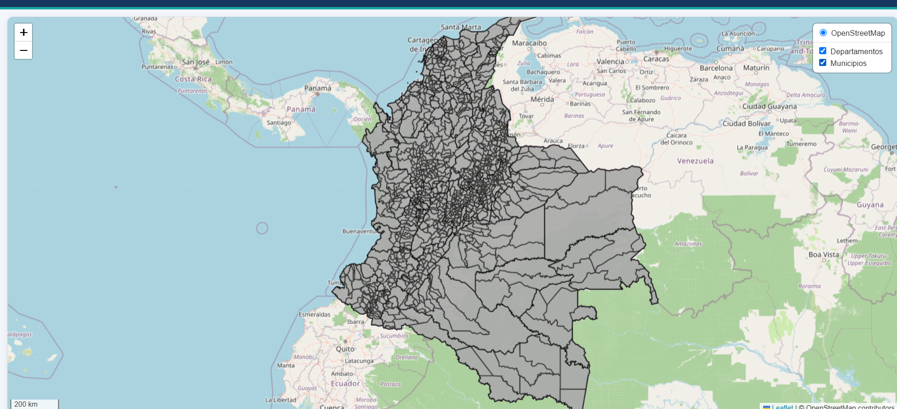

### 09. Respuesta GetFeatureInfo HTML mostrando Yolombó

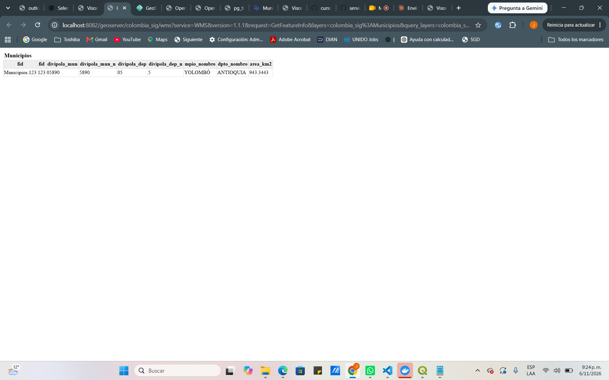

### 10. Ficha interactiva de Anapoima desde GeoServer

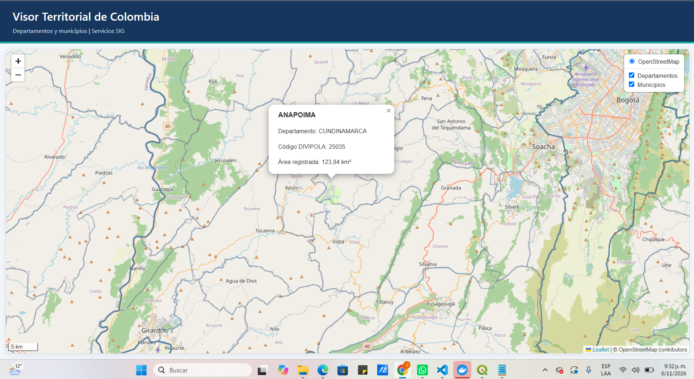

## Evidencias adicionales — versiones 2 y 3

Capturas obtenidas durante la construcción y comprobación del visor; documentan resultados observados en el navegador.

### Versión 2 — estilos transparentes y límites departamentales
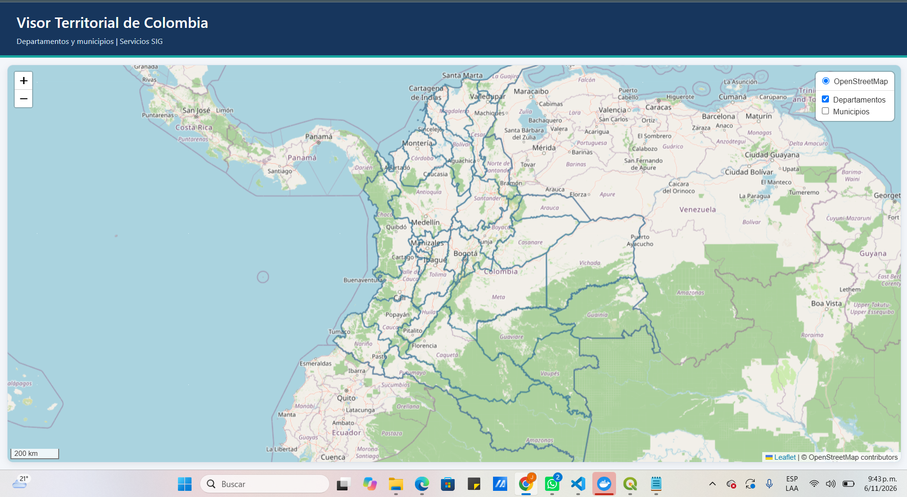

### Versión 2 — búsqueda y selección de Bogotá, D. C.
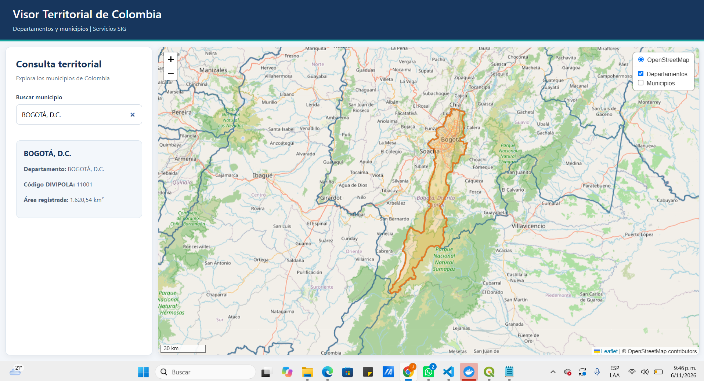

### Versión 3 — panel con estadísticas nacionales y selector departamental
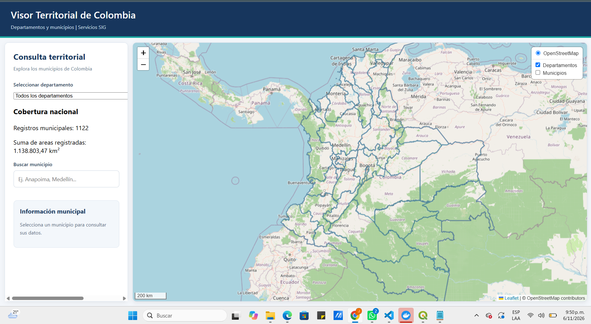

### Versión 3 — filtro Boyacá, 123 registros y selección de Chíquiza
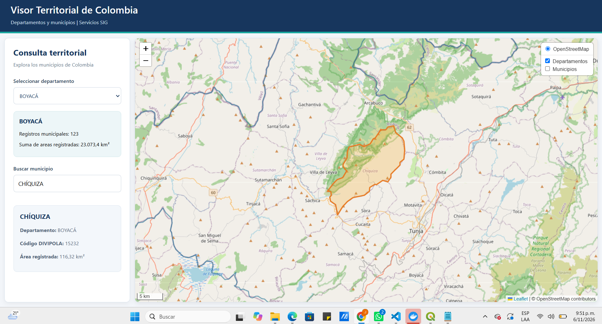

### Versión 3 — filtro Cundinamarca y selección de Funza
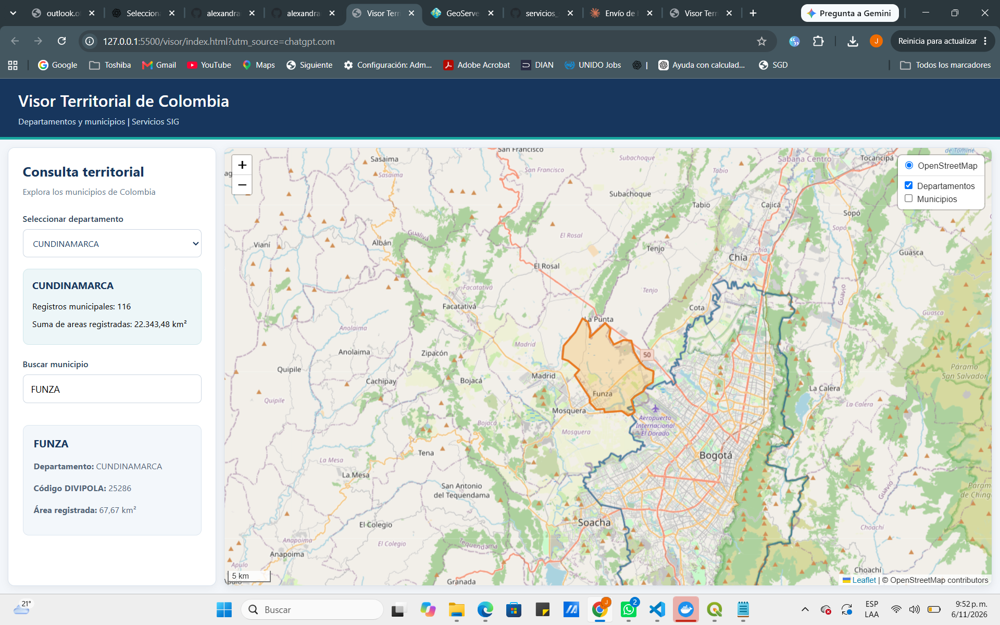

### Versión 3 — acercamiento automático al departamento de Boyacá
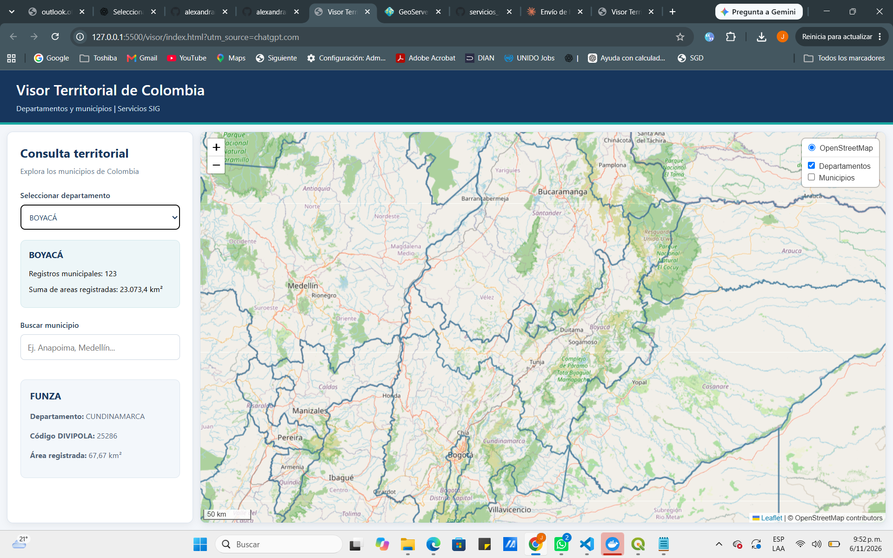

### Versión 3 — vista nacional final y panel de consulta
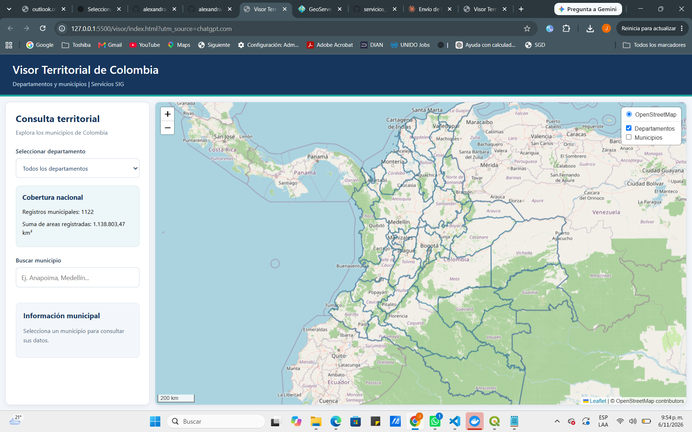

