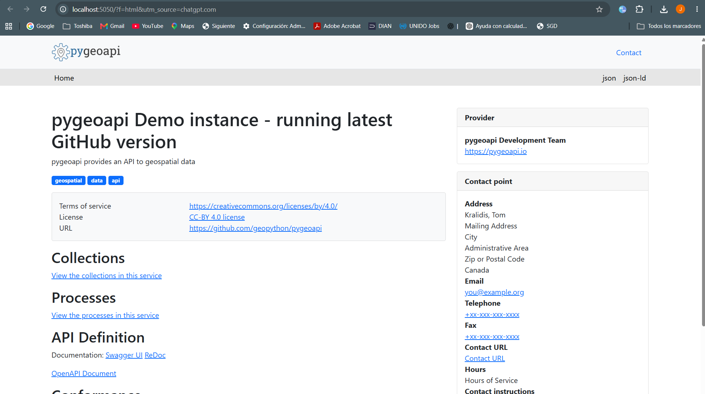
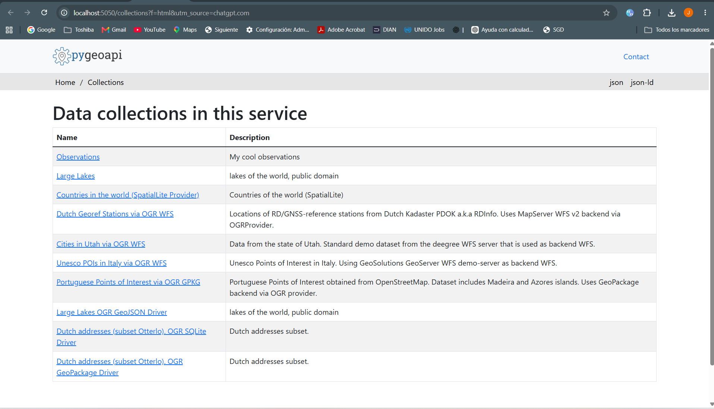

# Capítulo 10 — Evidencias de ejecución de pygeoapi

**Fecha de las pruebas:** 7 de noviembre de 2026  
**Entorno:** Docker local, servicio accesible en `http://localhost:5050`.

## Evidencia 01. Página principal de pygeoapi

**Figura 1.** Interfaz HTML de la instancia local de demostración de pygeoapi. Se observa la página principal del servicio con accesos a colecciones, procesos y documentación OpenAPI (Swagger UI / ReDoc). La captura acredita que la interfaz HTML carga en el navegador; no demuestra por sí misma la disponibilidad de cada operación interna.

## Evidencia 02. Colecciones publicadas

**Figura 2.** Página `http://localhost:5050/collections?f=html`. Muestra diez colecciones de demostración, entre ellas *Observations*, *Large Lakes*, *Countries in the world*, estaciones geodésicas neerlandesas, ciudades de Utah, puntos UNESCO de Italia y colecciones basadas en GeoPackage/GeoJSON/SQLite. La captura evidencia la publicación del catálogo HTML de colecciones.

## Verificaciones complementarias registradas en PowerShell

- La ruta `/` respondió **HTTP 200 OK** y se identificó como **pygeoapi 0.25.dev0**.
- El listado `/collections` devolvió diez colecciones.
- La consulta `GET /collections/lakes/items?limit=5` devolvió `type: FeatureCollection` y `numberReturned: 5`.

Estas comprobaciones se realizaron con la configuración **de demostración** de pygeoapi. No se ha demostrado la publicación de una colección propia con información de Colombia.

## Alcance

Las capturas corresponden a una aplicación ejecutada en `localhost`, por lo que **no son enlaces públicos de GitHub Pages**. Este directorio conserva las evidencias visuales del Capítulo 10; el Capítulo 11 corresponde al visor web desarrollado con Leaflet.
